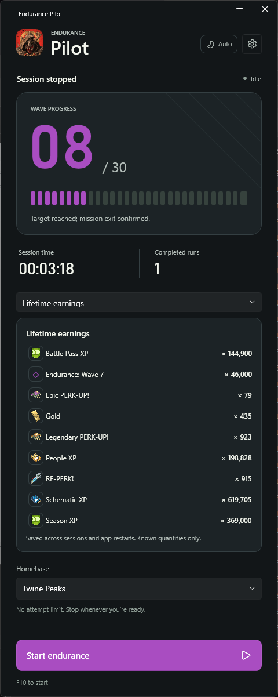

# Endurance Pilot

Endurance Pilot is a Windows app for running Fortnite **Save the World Storm Shield Endurance**. It navigates to your chosen Homebase, starts Endurance, tracks confirmed waves, collects mission rewards, and can repeat runs. It is early-access software, so check on a run if the game shows an unfamiliar screen.

*Screenshot from an earlier build. The current dashboard shows completed runs inside the earnings view and resets the wave display to 00 after a run.*

## Getting started

1. Install the latest Windows setup from [Releases](https://github.com/StwEndurancePilot/StwEndurancePilot/releases). The installer checks for the .NET 10 Windows Desktop Runtime.
2. Open the rounded **Epic account** switcher at the top and choose **Add account** to sign in on Epic's website. The switcher also lets you swap accounts, launch Fortnite, or open **Manage accounts** in the main window. You can add an authorization code, exchange code, or device auth credentials there too. Without a saved account, **Launch and restart Fortnite** uses the Epic Games Launcher as before.
3. Choose your **Homebase**. In **Settings**, set the target wave, whether to repeat indefinitely or stop after a chosen number of attempts, and whether to wait for assistance.
4. Select **Start endurance** or press the start/stop hotkey (F10 by default). Keep Fortnite focused while the runner is active. If you take control, use **Resume in Fortnite** when prompted.
5. Watch wave progress and review rewards under **This session**, **Latest mission**, or **Lifetime earnings**. Select **Stop runner** to end the session.

Settings also include an idle delay for refocusing Fortnite, a configurable hotkey, and optional Discord webhook notifications.

## Discord remote control

Pilot also includes an opt-in Discord application hosted in its own Cloudflare Worker. Pair your PC from **Epic account menu → Discord remote control** to request progress and statistics, manage accounts, approve Epic sign-in, capture the Fortnite window, show Pilot, and start or stop the runner. Game/account actions and screenshots require separate local permissions. Pilot must remain open on your PC.

See [Discord application setup and security](docs/discord-application.md) for deployment through GitHub environment secrets, pairing, commands, privacy boundaries and self-hosting. The source contains no shared bot or deployment token. The hosted Discord application must be configured and deployed before pairing is available.

Account credentials are encrypted for the current Windows user in `%LOCALAPPDATA%\EndurancePilot\accounts.json`. Signing in uses Epic's website; Endurance Pilot never asks for your Epic password. Account sign in and official game launch follow [Penny Launcher's](https://github.com/ahmed5939/penny-launcher) public implementation, with thanks to its contributors.

